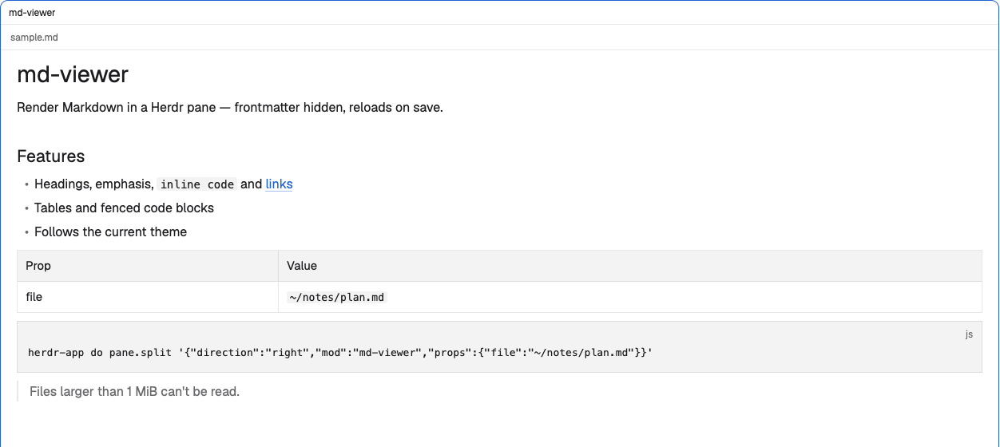

# herdr-md-viewer

在 [Herdr](https://herdr.dev) 桌面版（herdr app）的窗格中渲染 Markdown 檔案的 mod。

> **English:** A Herdr desktop app mod that renders a Markdown file in a pane — hides YAML frontmatter and reloads automatically when the file changes. Install by asking an agent in Herdr app to “add herdr.dev/mods/derekhsu/herdr-md-viewer”, or clone the repo elsewhere and `cp -R mods/md-viewer ~/.config/herdr-app/mods/`. Open it with `herdr-app do pane.split '{"direction":"right","mod":"md-viewer","props":{"file":"~/notes/README.md"}}'`. Files larger than 1 MiB cannot be read.



## 功能

- 以 Markdown 格式渲染指定檔案（標題、清單、表格、程式碼區塊等），文字可選取、可捲動。
- 自動隱藏檔案開頭的 YAML frontmatter（`---` 包住的區塊）。
- 監看檔案所在資料夾，檔案儲存後自動重新載入。
- 使用 herdr app 目前的主題配色。
- 窗格頂端顯示檔名。

## 安裝

### 方式一：請 herdr app 裡的 agent 安裝

本 mod 已收錄於 [herdr.dev/mods](https://herdr.dev/mods)。在 herdr app 的 agent 中輸入：

```text
加入 herdr.dev/mods/derekhsu/herdr-md-viewer
```

agent 會依 [RECIPE.md](RECIPE.md) 與檔案把 mod 複製到 `~/.config/herdr-app/mods/`，並以 `herdr-app check` 驗證。

### 方式二：手動安裝

repo 的結構與 herdr app 的 home（`~/.config/herdr-app`）相同，mod 在 `mods/md-viewer/`：

```sh
git clone https://github.com/derekhsu/herdr-md-viewer.git ~/src/herdr-md-viewer
cp -R ~/src/herdr-md-viewer/mods/md-viewer ~/.config/herdr-app/mods/
herdr-app check ~/.config/herdr-app/mods/md-viewer
```

資料夾名稱必須是 `md-viewer`，指令中的 `"mod":"md-viewer"` 才對得上。herdr app 會自動偵測新的 mod，不需要重新啟動。

### 更新

```sh
git -C ~/src/herdr-md-viewer pull
cp -R ~/src/herdr-md-viewer/mods/md-viewer ~/.config/herdr-app/mods/
```

herdr app 偵測到檔案變更後會就地重新載入已開啟的 viewer。

> herdr app 會在 mod 目錄自動產生 `gpui-kit.d.ts` 與 `jsconfig.json`，這兩個檔案已列在 `.gitignore`。

## 用法

`mod.json` 的 `place` 為 `none`，所以不會自動出現在版面中，要用 `herdr-app do` 開啟。`props.file` 必須是**絕對路徑**或以 `~/` 開頭。

在目前窗格右側開一個 Markdown 窗格：

```sh
herdr-app do pane.split '{"direction":"right","mod":"md-viewer","props":{"file":"~/notes/README.md"}}'
```

在新分頁中開啟：

```sh
herdr-app do tab.new '{"mod":"md-viewer","props":{"file":"/Users/me/project/docs/plan.md"}}'
```

在 shell 中開啟目前目錄的檔案（轉成絕對路徑）：

```sh
herdr-app do pane.split "{\"direction\":\"right\",\"mod\":\"md-viewer\",\"props\":{\"file\":\"$PWD/README.md\"}}"
```

## 限制

- herdr app 的 mod 讀檔上限為 **1 MiB**，超過的檔案無法顯示。
- 只接受絕對路徑或 `~/...`；相對路徑不會被解析。
- 只顯示單一檔案；Markdown 內的連結與相對路徑圖片不保證可用。
- 介面訊息（讀取中、找不到檔案等）為繁體中文。

## 授權

[MIT](LICENSE)
