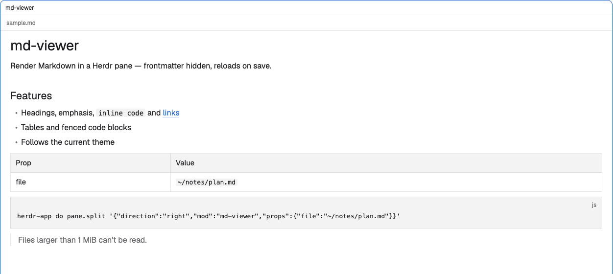

# Markdown Viewer

A pane that renders one Markdown file: a thin header with the file name and the rendered document below it, selectable and scrollable, in the current theme's colors. YAML frontmatter at the top of the file is hidden, and the view reloads by itself when the file is saved. It opens beside a terminal or as its own tab with `props.file`.

## What you see

Top to bottom, filling the pane, on the theme's `surface` color with `foreground` text:

1. **Header** (12 px horizontal / 6 px vertical padding, 1 px bottom border in `border`, falling back to `dim`): the file's base name in 12 px `muted` text, truncated. With no file it says `Markdown`.
2. **Body** (takes the rest of the height, `min_h(0)` so it can shrink): the document rendered by `TextView.markdown` with 20 px horizontal and 12 px vertical padding — headings, paragraphs, lists, links, inline code, tables (header row shaded), fenced code blocks (shaded box with the language name at the top right) and block quotes (left rule, muted text). Text can be selected; the body scrolls on its own.

States, shown instead of the body as 16 px-padded text: `讀取中…` (`dim`) while loading; `沒有指定檔案（props.file）`, `找不到檔案：<path>` and `讀取失敗：<message>` (`muted`).

## How it behaves

- **Frontmatter**: a block that starts on the file's first line with `---` and ends at the next line that is exactly `---` is removed before rendering (LF or CRLF). Anything else — including a `---` rule further down — is left alone.
- **Reload**: after the first load, the mod watches the file's folder with `watchFolder` in a loop. When a changed path is the file itself, or the folder (meaning "refresh everything"), it reads the file again and redraws. Scroll position is whatever `TextView` keeps for the same id (`"md"`).
- **Close**: `close()` cancels the pending watch so the loop ends.
- No clicks, keys, hovers or agent statuses of its own; `focusable` is false, so pane navigation skips it.

## Built from

- `mods/md-viewer/mod.json`: `{ "place": "none", "title": "Markdown", "focusable": false }` — it never docks by itself; open it with
  `herdr-app do pane.split '{"direction":"right","mod":"md-viewer","props":{"file":"~/notes/plan.md"}}'` or
  `herdr-app do tab.new '{"mod":"md-viewer","props":{"file":"/abs/path.md"}}'`.
- `mods/md-viewer/main.js`: one `View` class, about 60 lines.
  - `gpui-kit`: `View`, `div`.
  - `gpui-base`: `v_flex`, `h_flex`, `TextView.markdown(id, text).selectable(true).scrollable(true)`.
  - `herdr`: `props()` (`file`: absolute, or `~/…` expanded with `home()`), `readTextFile` (returns `null` when the file is missing), `watchFolder(dir)` in a `cx.spawn` loop, `theme()` (`surface`, `foreground`, `border`, `muted`, `dim`), `checking()` (no watcher under `herdr-app check`).
- No programs, no network, no writes, no icons or other assets.

## Watch out

- It **reads a file outside its own folder** — whatever `props.file` points to — and watches that file's folder. It does not run programs, reach the network or write anything.
- `readTextFile` refuses files over **1 MiB**; the pane then shows `讀取失敗：…`. There is no fallback.
- Relative paths in `props.file` are not resolved; use an absolute path or `~/…`.
- `watchFolder` is recursive on macOS and Windows, so a file in a huge folder (your home, a big repo) wakes the loop on every change below it; the mod only reloads for its own file, but don't point it at files directly in `~`. On Linux, trees over 4096 non-ignored directories reject the watch and the view will not auto-reload.
- Relative image paths and links inside the Markdown are not rewritten against the file's folder, so they may not show or open.
- With the default UI font, bold and italic can look close to body text.
- UI strings are Traditional Chinese.
